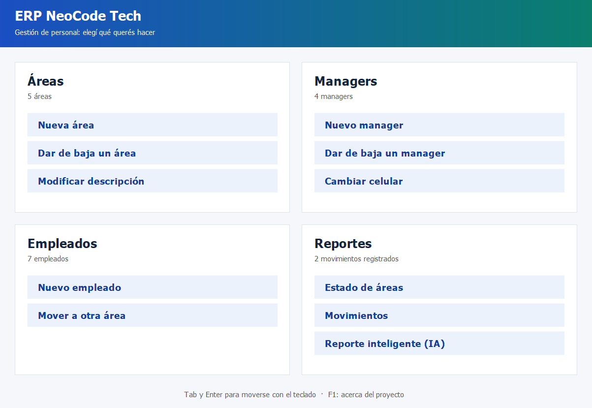
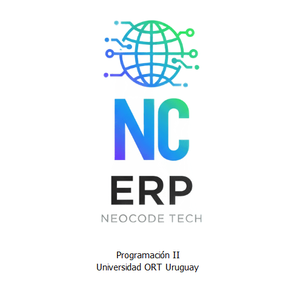
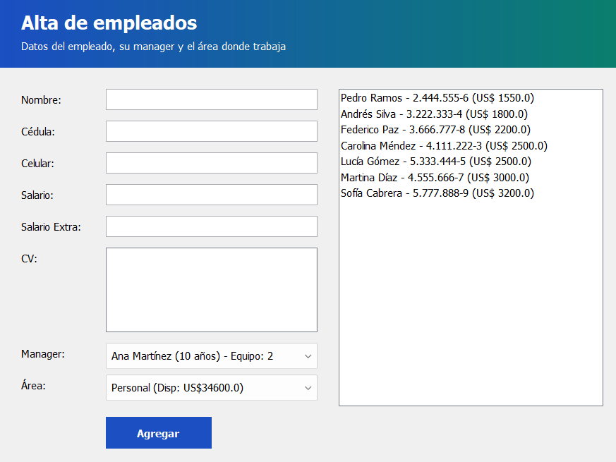
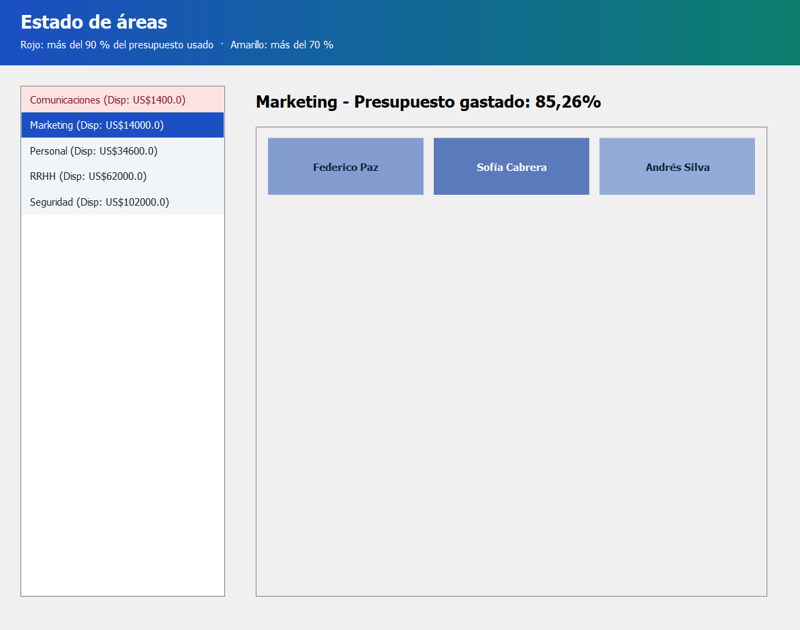
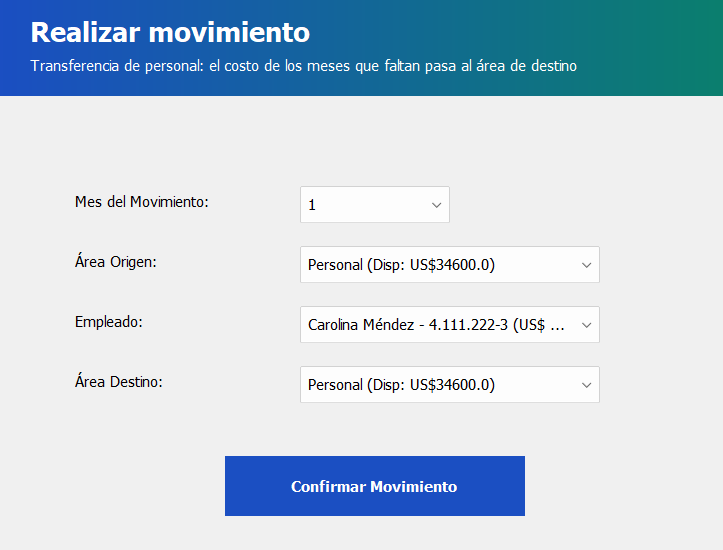
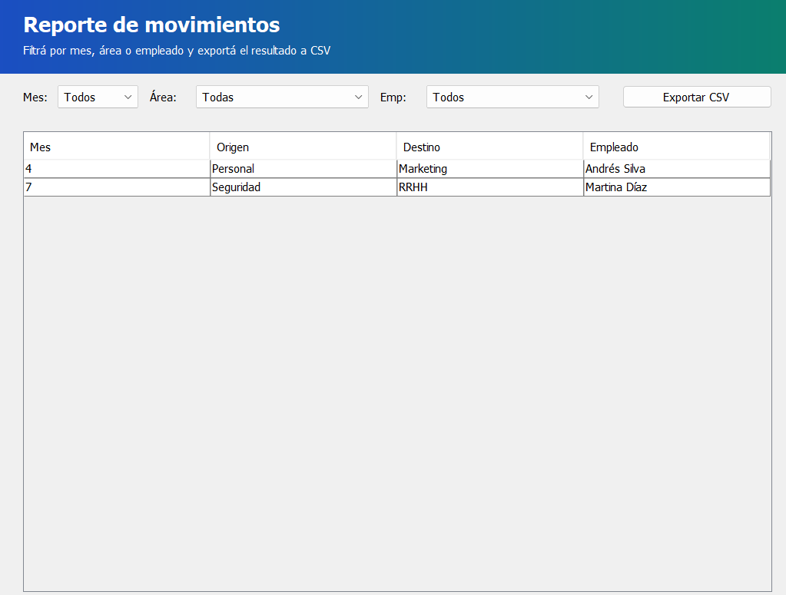
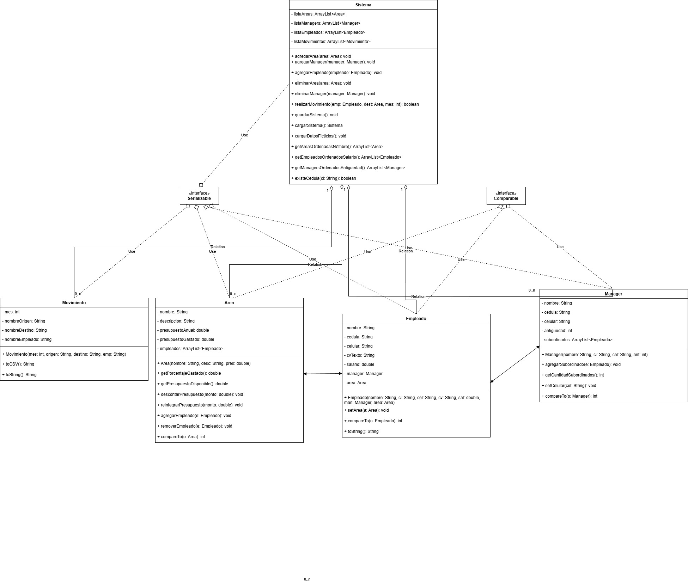

# Sistema ERP de gestión de personal

Aplicación de escritorio en Java para gestionar el personal de una empresa: áreas con su presupuesto anual,
managers, empleados y los movimientos de empleados entre áreas. Incluye reportes y un análisis con
inteligencia artificial (Google Gemini) de las ventajas y desventajas de mover a un empleado de área.

> Proyecto académico: obligatorio de **Programación II**, Licenciatura en Sistemas, Universidad ORT Uruguay
> (2do semestre de 2025).



## Qué hace

- **Áreas:** alta con nombre, descripción y presupuesto anual; baja (solo de áreas sin empleados) y
  modificación de la descripción.
- **Managers:** alta, baja (solo si no tiene empleados a cargo) y modificación del celular. Se listan por antigüedad.
- **Empleados:** alta con manager, área, salario mensual y CV (se guarda como archivo de texto en `cvs/`).
  Solo se acepta si el área tiene presupuesto para 12 salarios.
- **Movimientos:** pasa un empleado a otra área desde un mes dado. El costo de los meses que faltan se
  descuenta del área destino y se devuelve al área de origen; si el destino no tiene presupuesto, no se hace.
- **Reportes:**
  - *Estado de áreas*: porcentaje del presupuesto usado, en rojo si pasa el 90 % y en amarillo si pasa el 70 %.
  - *Movimientos*: filtros por mes, área y empleado, y exportación a CSV.
  - *Reporte inteligente (IA)*: para un empleado y un área destino, Gemini lista 3 ventajas, 3 desventajas y
    una recomendación a partir del CV.
- **Persistencia:** al cerrar, todo se guarda en `sistema.ser` (serialización de Java). Al abrir se puede empezar
  vacío, cargar lo guardado o usar los datos ficticios de la letra del obligatorio.

## Capturas

| | |
|---|---|
|  |  |
|  |  |
|  |  |

## Cómo está hecho

- **Java 8** con **Swing**. Las pantallas se maquetaron con el diseñador de NetBeans y el comportamiento está
  escrito a mano.
- Separación en paquetes:
  - `dominio`: las clases del negocio (`Sistema`, `Area`, `Manager`, `Empleado`, `Movimiento`), sin código de interfaz.
  - `gui`: las ventanas, que solo usan el dominio.
  - `inicioAPP`: el punto de entrada (`Main`).
- **Gson 2.10.1** (en `lib/`) para armar y leer el JSON de la API de Gemini (modelo `gemini-2.5-flash`).
- Proyecto de **NetBeans** (Ant).



## Cómo ejecutarlo

Requisitos: JDK 8 o superior. Para el reporte con IA, además, una clave de la API de Gemini.

### Clave de la API (solo para el reporte con IA)

El programa lee la clave de la variable de entorno `ERP_API_KEY` (ver [`config.ejemplo`](config.ejemplo)).
En Windows, desde PowerShell:

```powershell
setx ERP_API_KEY "tu-clave"
```

Después hay que cerrar y volver a abrir NetBeans o la terminal. La clave se crea gratis en
[Google AI Studio](https://aistudio.google.com/apikey). Sin la clave, el resto de la aplicación funciona igual.

### Con NetBeans

Abrir la carpeta del proyecto (*File → Open Project*) y ejecutarlo con *Run* (F6).

### Desde la terminal

Con [Apache Ant](https://ant.apache.org/) (viene con NetBeans):

```powershell
ant jar
java -cp "dist/sistemaERP.jar;lib/gson-2.10.1.jar" inicioAPP.Main
```

En Linux o macOS el separador del classpath es `:` en lugar de `;`.

Los datos (`sistema.ser`) y los CV (`cvs/`) se guardan en la carpeta desde la que se ejecuta.
